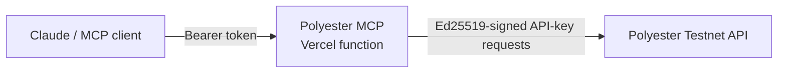

<div align="center">

# Polyester MCP

**An MCP connector that gives Claude safe, confirmation-gated access to your Polyester Testnet account.**


[Overview](#overview) · [Tools](#tools) · [Quick start](#quick-start) · [Configuration](#configuration) · [Security](#security) · [Project structure](#project-structure)

---

## Overview

Polyester MCP is a small [Model Context Protocol](https://modelcontextprotocol.io) server. It lets an MCP client such as Claude check balances and claim the daily testnet reward, and nothing else.

| | |
|---|---|
| **Transport** | Streamable HTTP, stateless per request |
| **Endpoint** | `/api/mcp` |
| **Hosting** | Vercel (Node.js serverless function) |
| **Deploys from** | GitHub branch `main` |
| **Runtime** | Node.js 22 |
| **Auth** | Bearer token between the client and this server; Ed25519-signed requests between this server and Polyester |



## Tools

| Tool | Access | What it does |
|---|:---:|---|
| `polyester_get_balances` | Read | Returns every supported token balance for the authenticated account, including zero balances. |
| `polyester_daily_claim_status` | Read | Shows today's reward, claim state, reset time and reward assets. |
| `polyester_claim_daily_reward` | Write | Claims today's reward. Requires the exact confirmation string `CLAIM_DAILY_REWARD`. |

No swap, trading, transfer or withdrawal tools are exposed.

## Quick start

**1. Install**

```bash
npm install
cp .env.example .env     # then fill in the values
```

**2. Build check**

```bash
npm run build
```

**3. Deploy**

Push to `main`. Vercel builds `api/mcp.ts` and routes `/api/mcp` to it through `vercel.json`.

**4. Connect Claude**

Add a custom connector with these settings:

| Setting | Value |
|---|---|
| Server URL | `https://<your-vercel-deployment>/api/mcp` |
| Authentication | No sign-in |
| Request header | `Authorization: Bearer <MCP_BEARER_TOKEN>` |

## Configuration

Set these in the Vercel project settings for both **Preview** and **Production**, or in `.env` for local runs.

| Variable | Required | Description |
|---|:---:|---|
| `MCP_BEARER_TOKEN` | Yes | Random secret of at least 32 characters. The MCP client sends it as a Bearer token. |
| `POLYESTER_API_KEY_ID` | Yes | Polyester API key ID. |
| `POLYESTER_API_PRIVATE_KEY` | Yes | Ed25519 signing seed. Keep it secret. |
| `CRON_SECRET` | For auto-claim | Random secret of at least 32 characters. Vercel Cron sends it as a Bearer token to `/api/auto-claim`. |
| `POLYESTER_BASE_URL` | No | Defaults to `https://api.testnet.polyester.com`. |

The MCP bearer token is separate from the Polyester API credentials.

## Automatic daily claim

A Vercel Cron job calls `/api/auto-claim` every day at **00:05 UTC**, shortly after the daily reward resets. The endpoint checks the claim status first and claims only when a reward is available, so repeated runs are harmless.

- Requires the `CRON_SECRET` environment variable (at least 32 characters). Requests without the matching Bearer token get `401`.
- Uses the same Polyester API key and the Claim Daily Reward permission as the MCP tool.
- Check results in the Vercel dashboard under **Logs** or **Settings → Cron Jobs**.

## Polyester API key permissions

Give the API key only what these tools need:

| Permission | Access | Used by |
|---|:---:|---|
| Balances | Read | `polyester_get_balances` |
| Daily Reward Status | Read | `polyester_daily_claim_status` |
| Claim Daily Reward | Write | `polyester_claim_daily_reward` |

## Security

**Minimal surface.** Only balance and daily-reward tools exist. There are no swap, transfer or withdrawal tools.

**Explicit confirmation.** A claim is sent only when the exact `CLAIM_DAILY_REWARD` confirmation is supplied, and never automatically.

**Secrets stay on the server.** API credentials are read only from environment variables and never returned in responses.

**Constant-time token check.** Incoming Bearer tokens are compared with `timingSafeEqual`, and tokens shorter than 32 characters are rejected.

**Never commit secrets** or paste private keys into chat.

## Project structure

```
.
├── api/
│   ├── mcp.ts              # Vercel serverless handler and tool definitions
│   └── auto-claim.ts       # Cron-triggered daily reward claim
├── src/
│   └── polyester-auth.ts   # Request signing, ConnectRPC calls and balance lookup
├── .env.example            # Environment variable template
├── vercel.json             # Vercel build and routing config
└── package.json
```

## Scripts

| Command | Description |
|---|---|
| `npm run build` | Type-check and compile TypeScript to `dist/`. |

</div>
